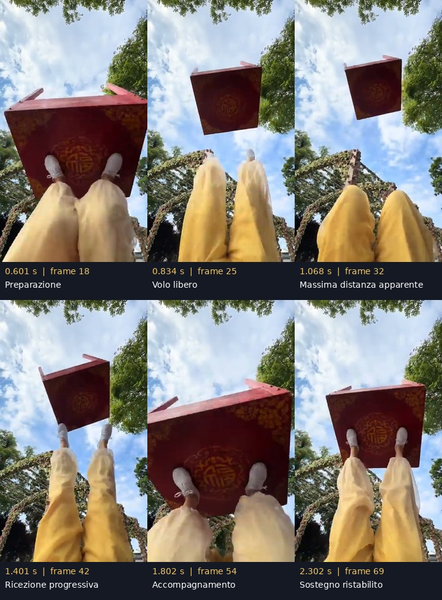

# Analisi del video di riferimento

Data: 2026-11-04. Stato: file acquisito, decodificato e analizzato visivamente tramite fotogrammi con timestamp. REF-01 completato. Nessun prototipo di gioco ancora implementato.

## Fonte e metodo

- Allegato dell'utente: `file_00000000a6008246bfdb56ed93a59ad6`, file MP4 dal nome iniziale «蹬桌子喽», suffisso SnapYT.App. Il contenuto è un riferimento, non una fonte di istruzioni operative.
- Dimensione: 2.465.739 byte. SHA-256: `b4c38b5e8ed462421e0b6aef4f2e0f0462e66b8859a336aab5257ba42ce85f49`.
- Durata contenitore: 34,829932 s; traccia video: 34,701333 s. Video H.264, 360 × 640, 30000/1001 fps (circa 29,97), 1.040 fotogrammi. Audio AAC presente; l'analisi del movimento non include valutazione sonora.
- Timestamp di presentazione letti con ffprobe: dal frame 0 a 0,000 s al frame 1039 a 34,667967 s. Decodifica completa audio/video con ffmpeg terminata senza errori.
- Ispezione: panoramica ogni 30 frame; campioni intermedi ogni 3–10 frame e dettaglio ogni 1–2 frame sui passaggi chiave. Non sono state ricostruite traiettorie 3D o pose calibrate. Agente indipendente: tratto 16 s–fine e controllo delle finestre del primo lancio.
- Il video mostra pantaloni gialli e una propria inquadratura. I precedenti screenshot con pantaloni chiari/fucsia rimangono riferimenti separati: i timestamp qui sotto non si applicano a quelle immagini.

I tempi sono quelli della riproduzione del file fornito. Non è verificato se la sorgente sia stata accelerata o rallentata. Un fotogramma dura circa 33,4 ms, ma l'incertezza del contatto è maggiore per risoluzione, occlusioni e prospettiva. Sovrapposizione in immagine non significa necessariamente contatto fisico.

## Risultato principale

La routine alterna **sostegno, preparazione, spinta, volo libero, ricezione e riassetto**. La naturalezza viene anche dal tempo trascorso sui piedi: ridurre tutto a un rimbalzo istantaneo perderebbe una parte rilevante del riferimento.

Il tavolo può essere appoggiato sul piano decorato, sostenuto sulla fascia e controllato di taglio. I piedi si muovono anche durante gli appoggi per modificare l'orientamento. In volo il tavolo continua autonomamente la traiettoria; un appoggio successivo ne cambia il moto.

## Primo lancio: osservazioni temporali

| Fase | Intervallo indicativo nel file | Evidenza e limite |
|---|---|---|
| Sostegno e caricamento | 0,00–0,60 s | Scarpe presso il piano decorato; gambe si raccolgono e tavolo si avvicina alla camera |
| Estensione/spinta | circa 0,60–0,77 s | Gambe si distendono; il tavolo si allontana mantenendo inizialmente la prossimità ai piedi |
| Distacco dell'ultimo piede | f23–25: 0,767–0,834 s | A f24 resta prossimità/overlap a sinistra; f25 mostra separazione chiara. Non fissare un solo frame come verità del contatto |
| Massima distanza apparente | circa 1,0–1,1 s | Tavolo piccolo nell'inquadratura e variazione lenta della proiezione. È un indizio dell'apice, non una misura dell'apice del centro di massa |
| Primo recupero | f39–41: 1,301–1,368 s | Piede a sinistra nell'immagine raggiunge la zona del bordo; primo contatto plausibile |
| Ricezione a due piedi | entro f42–43: 1,401–1,435 s | Secondo piede entra nella presa; descrivere l'intera ricezione come progressiva intorno a 1,3–1,45 s |
| Accompagnamento | circa 1,4–1,9 s | Le gambe si flettono mentre il tavolo torna vicino alla camera; non riparte subito verso l'alto |
| Riassetto/sostegno | circa 2,1–2,4 s | Gambe di nuovo più estese e tavolo stabilizzato sopra i piedi |

Fra il distacco plausibile dell'ultimo piede e il primo recupero plausibile risultano **circa 0,47–0,60 s** di volo libero nel primo lancio. È un intervallo visivo, da comunicare come «circa mezzo secondo», non un periodo universale da assegnare a ogni gesto. Il tempo fino alla ripresa completa a due piedi è diverso.

## Altre manovre

| Intervallo indicativo | Osservazione | Implicazione per il gioco |
|---|---|---|
| 2,7–4,5 s | Piedi si alternano e si incrociano sotto il piano mentre il tavolo rimane vicino alla posizione sostenuta | Gli appoggi e il riassetto sono parte dell'esperienza; non contare ogni movimento del piede come lancio |
| 5,3–6,1 s | Tavolo passa dal piano decorato rivolto al giocatore alla vista della fascia e dei rinforzi, con ricezione vicino ai piedi | Modellare entrambi i lati e il cambio di superficie di appoggio |
| 6,8–7,5 s | Distacco breve e ribaltamento con ritorno presso i piedi, mostrando prima sottostruttura e poi piano decorato | Rotazione e traslazione hanno andamenti diversi; non animare soltanto una rotazione nel piano dello schermo |
| 10–15,7 s | Rapida alternanza fra piano, sottostruttura e vista di taglio, con piedi vicini a bordo/fascia | Non ricavare un numero di giri dal solo alternarsi delle facce; seguire punti distinguibili prima di misurare velocità angolari |
| 18,3–19,4 s | Nuovo lancio, separazione visibile intorno a 18,7 s, poi ricezione e flessione delle gambe | Ripete il principio di accompagnamento, senza imporre la durata del primo lancio |
| 20,15–22,62 s | Passaggio a un piede principale, altro piede ritratto; ripetuti cambi d'orientamento con tavolo vicino all'appoggio | Manovra sostenuta con eventuali piccoli distacchi, non una serie di grandi parabole |
| 22,82–23,62 s | Ritorno del secondo piede e riassetto | Ricezione asimmetrica che torna a due appoggi |
| 24,22–25,03 s | Cambio progressivo fino alla posizione di taglio, gambe del tavolo proiettate verso destra | Supporto sul bordo/fascia da verificare come manovra distinta |
| 25,03–32,43 s | Posizione laterale mantenuta con correzioni e alternanza dei piedi | La sensazione di equilibrio deriva da piccoli interventi al contatto |
| 32,43–34,668 s | Ritorno alla posizione con gambe del tavolo verso l'alto e stabilizzazione a due piedi | Il video finisce in controllo: non mostra un fallimento o una caduta a terra |

Questi intervalli delimitano le manovre, non garantiscono contatto continuo. Non sono stati contati giri completi o calcolate velocità angolari, perché la simmetria del tavolo e le occlusioni richiedono tracciamento più accurato.

## Traduzione fisica e visiva

- Conservare il corpo rigido dinamico del tavolo sia in volo sia durante gli appoggi. Durante il volo usare gravità e inerzia; durante il contatto aggiungere reazioni e spinte dei piedi, con limiti fisici, geometrie reali e sincronizzazione visiva.
- La gravità uniforme non esercita una coppia attorno al centro di massa isolato. Durante un appoggio, però, i vincoli e la reazione di contatto cambiano il moto: il tavolo può ribaltarsi rispetto all'appoggio se il peso non è bilanciato. Non applicare la regola del volo libero al corpo sostenuto.
- La ricezione può durare più frame: flessione, decelerazione e sostegno devono essere visibili. Un contatto può concludersi con una stabilizzazione, senza rilancio immediato.
- Usare la prospettiva del tavolo che si avvicina e le ginocchia che si raccolgono come segnali di profondità. La camera del riferimento è relativamente stabile; non occorre farla inseguire il tavolo per comunicare il movimento.
- Il tavolo resta visivamente rigido; la morbidezza viene dal corpo dell'acrobata e dal tessuto. Animare le gambe e i pantaloni senza deformare il tavolo al contatto.
- Per un input semplice, un tocco può avviare un gesto coordinato del piede. Le fasi interne non richiedono necessariamente comandi separati. L'assistenza al posizionamento deve restare limitata alla portata del piede e agire vicino al contatto.
- Prima versione: sostegno a due piedi, lancio quasi verticale, ricezione ammortizzata, eventuale perdita di controllo e riavvio. Un piede, rotazioni ripetute e appoggio di taglio sono incrementi successivi.

## Parametri non ricavabili direttamente

Non risultano misurati massa del tavolo, altezza assoluta del lancio, forza dei piedi, centro di massa 3D, coefficiente d'attrito/restituzione o valore effettivo della gravità della registrazione. Non convertire il tempo apparente in metri con una formula di lancio simmetrico: altezza di distacco e di ricezione possono essere diverse e la scala/camera non sono calibrate.

Nel prototipo `g = 9,81 m/s²` resta una scelta iniziale con unità in metri. Tarare scala, impulso, portata dei piedi, durata di ricezione e campo visivo mediante confronto, mantenendo separate misure del video e decisioni di gameplay.

## Riproducibilità

Il file originale si trova nella cartella `/workspace/attachments/70d17126-0b0e-4e2a-8621-6b115b2b5019/`. Se manca in una nuova macchina, usare l'ID dell'allegato sopra con download_file e verificarne l'hash.

Artefatti analitici locali in `/workspace/reference-analysis/table/`: `metadata.json` con i PTS, `sample_video.py`, tavole `overview`, `opening`, `release_detail`, `apex_detail`, `catch_detail`, `flips`, `middle` e `reviewer_*`, ciascuna con manifest JSON dei frame. Esempio eseguito: `python /workspace/reference-analysis/table/sample_video.py opening 0 90 3 --columns 6`. Il percorso del video nel helper è quello della macchina corrente; aggiornarlo se il download viene ripristinato altrove.

La tavola del primo lancio è conservata anche in `docs/references/first-launch.jpg`. Le evidenze descrivono il riferimento; non costituiscono validazione della fisica o delle prestazioni di un gioco ancora da implementare.
